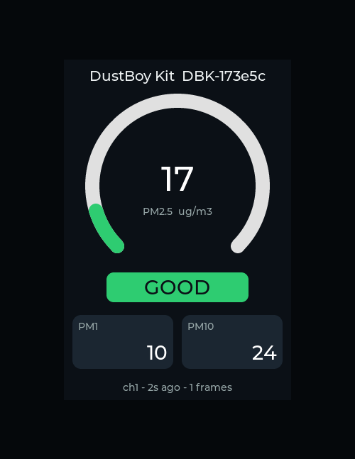

# DustBoy Kit screen in the browser (LVGL + WebAssembly)

The kit's 320 x 480 LVGL screen, running in a web page with no hardware.

`src/main.c` is a plain-C copy of [`screen/lvgl-ui.yaml`](../screen/lvgl-ui.yaml)
(ESPHome YAML cannot compile to WebAssembly). It uses LVGL v9 and LVGL's own SDL2
driver, compiled with Emscripten. The data is fake, the same sweep as
[`screen/lvgl-host.yaml`](../screen/lvgl-host.yaml): PM2.5 goes 0 to 120 and back
over 60 s, PM1 = 0.62x, PM10 = 1.45x, updated once a second, so the arc and chip
show green (GOOD, <= 25), yellow (FAIR, <= 50) and red (POOR).



## Files

| File | What |
|------|------|
| `src/main.c` | the UI and the fake data |
| `lv_conf.h` | LVGL settings (only what differs from LVGL's defaults) |
| `shell.html` | page template; Emscripten writes `dist/index.html` from it |
| `build.sh` | build script, safe to re-run |

## Build

Needs Emscripten (`emcc`, tested with 5.0.7) and an LVGL v9 checkout outside this repo
(tested with tag `v9.6.0`):

```
git clone --depth 1 --branch v9.6.0 https://github.com/lvgl/lvgl /opt/tmp/dustboy-kit-oracle/lvgl-src
./build.sh                                  # LVGL_DIR defaults to the path above
LVGL_DIR=/path/to/lvgl ./build.sh           # or point it somewhere else
```

The output goes to `dist/` (`index.html`, `index.js`, `index.wasm`). Object files are
cached in `build/` (git-ignored), so a second run only relinks.

## Serve locally

The page must come over HTTP (browsers will not load `.wasm` from `file://`):

```
python3 -m http.server 8981 --bind 127.0.0.1 --directory dist
```

Open http://127.0.0.1:8981/.

## Notes

- The main loop runs at 30 fps on `setTimeout`, not `requestAnimationFrame`, so the
  data keeps moving in headless browsers and background tabs.
- Headless Chrome on macOS lays the page out at least 500 px wide, so the screenshot
  was taken with `--window-size=500,647 --virtual-time-budget=8000`.
